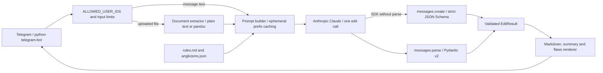

# ai-redaktor

Proofread Russian text and documents in Telegram, returning corrected Markdown and an itemized edit report.

[](https://github.com/Gleb-Sergeevich-Loktionov/ai-redaktor/actions/workflows/ci.yml)     

## Key Engineering Highlights

- The Telegram adapter checks `ALLOWED_USER_IDS` when configured and enforces character and file-size limits before calling the editing core.
- Plain-text extraction supports `.txt`, `.md`, and `.csv`. Pandoc converts `.docx`, `.odt`, and `.rtf` to Markdown.
- The prompt uses `config/rules.md` and `config/anglicisms.json` and marks the stable prefix for ephemeral caching.
- Each edit uses one Claude request. The core validates output with Pydantic v2 through `messages.parse`, or uses strict JSON Schema when that SDK method is unavailable.
- The renderer produces `corrected.md`, a summary, and an issue list inline or as `flaws.md`. CI runs 33 pytest tests including pandoc extraction.

## Architecture



## Как это работает

- **Один вызов Claude на текст**, структурный (JSON) вывод — без состояния между запросами.
- **Ядро** (`src/core.py`) ничего не знает про Telegram: `edit(text, rules, glossary)` →
  `{edited_text, summary, comments}`. Telegram — тонкий адаптер (`src/bot.py`) поверх того же
  контракта, поэтому новый канал (Notion, веб) добавляется как ещё один адаптер, не трогая ядро.
- **Словарь англицизмов и правила стиля — это данные**, а не код (`config/`): правятся без
  изменения кода и подмешиваются в промпт. Стабильный префикс промпта помечен для
  prompt-кэширования.

Что бот присылает в ответ на текст/файл:

1. `corrected.md` — исправленный текст файлом.
2. Саммари: сколько исправлений, какие англицизмы заменены, заметки по стилю.
3. Перечень изъянов, сгруппированный по типам (орфография, пунктуация, грамматика,
   англицизмы, стиль, логика). Короткий — сообщением, длинный — файлом `flaws.md`.

## Требования

- **Python 3.12**
- Системный **pandoc ≥ 2.14.2** — нужен для `.docx/.odt/.rtf` (проверяется на старте, fail-fast).
  На вход `.rtf` версия ниже 2.14.2 не годится.
- **Токен Telegram-бота** от [@BotFather](https://t.me/BotFather)
- **Ключ Anthropic API**

## Установка и запуск

```bash
# 1. Зависимости (нужен установленный в системе pandoc)
pip install -r requirements.txt

# 2. Конфигурация
cp .env.example .env
# заполните TELEGRAM_BOT_TOKEN и ANTHROPIC_API_KEY

# 3. Запуск (long-polling — публичный HTTPS/webhook не нужен)
python -m src.bot
```

### Docker

Образ уже содержит pandoc, ставить его отдельно не нужно:

```bash
docker build -t ai-redaktor .
docker run --rm --env-file .env ai-redaktor
```

Секреты передаются окружением контейнера — `.env` в образ не копируется (см. `.dockerignore`).

## Переменные окружения

| Переменная | Обязательна | По умолчанию | Описание |
|---|---|---|---|
| `TELEGRAM_BOT_TOKEN` | да | — | Токен бота от @BotFather |
| `ANTHROPIC_API_KEY` | да | — | Ключ Anthropic API |
| `MODEL` | нет | `claude-sonnet-4-6` | Идентификатор модели Claude. Сверяйте актуальные ID и цены в [документации Anthropic](https://docs.anthropic.com). |
| `MAX_CHARS` | нет | `20000` | Максимум символов на один запрос (защита от стоимости и лимитов) |
| `MAX_FILE_MB` | нет | `10` | Максимальный размер входного файла, МБ |
| `ALLOWED_USER_IDS` | нет | — | Telegram user ID через запятую; если задано, доступ открыт только указанным пользователям |

## Использование

1. Откройте бота и отправьте `/start`.
2. Пришлите текст сообщением **или** прикрепите файл `.txt/.md/.csv/.docx/.odt/.rtf`.
3. Получите `corrected.md`, саммари и перечень изъянов.

Ограничения по умолчанию: текст длиннее `MAX_CHARS` и файлы больше `MAX_FILE_MB` отклоняются
с понятным сообщением; из офисных форматов извлекается текст (исходная вёрстка не сохраняется).

## Настройка правки (без кода)

- `config/anglicisms.json` — словарь англицизмов: списки «заменять всегда» и «заменять с
  оглядкой на контекст» (`term → replace`, опционально `note`).
- `config/rules.md` — правила стиля, которые подмешиваются в промпт.

Меняете эти файлы — меняется поведение редактуры, перезапуск кода не требуется.

## Разработка

```bash
pip install -r requirements-dev.txt
pytest
```

## Структура проекта

```
src/
├── bot.py            # тонкий Telegram-адаптер (async, long-polling)
├── core.py           # ядро: один вызов Claude, структурный вывод (Telegram-агностично)
├── prompts.py        # сборка промпта (система + правила + словарь + текст)
├── extract.py        # извлечение текста: плоские форматы — чтением, офисные — через pandoc
├── render.py         # сборка ответа: файл + саммари + перечень изъянов
├── models.py         # контракт ядра (Pydantic, frozen): EditResult/Summary/Comment
├── config_loader.py  # загрузка config/ (правила + словарь)
└── settings.py       # чтение .env, health-check pandoc
config/               # ДАННЫЕ (не код): словарь англицизмов + правила стиля
docs/                 # архитектура, устройство промпта, принципы
tests/                # pytest
Dockerfile            # один контейнер (python:3.12-slim + pandoc)
```

Подробности — в `docs/`: [`ARCHITECTURE.md`](docs/ARCHITECTURE.md) (архитектура и контракт ядра),
[`PROMPT.md`](docs/PROMPT.md) (устройство промпта), [`PRINCIPLES.md`](docs/PRINCIPLES.md) (инженерные принципы).

## Лицензия

[MIT](LICENSE) © 2026 Gleb Sergeevich Loktionov.
